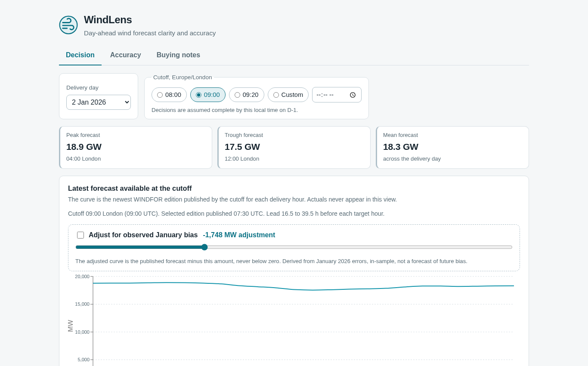
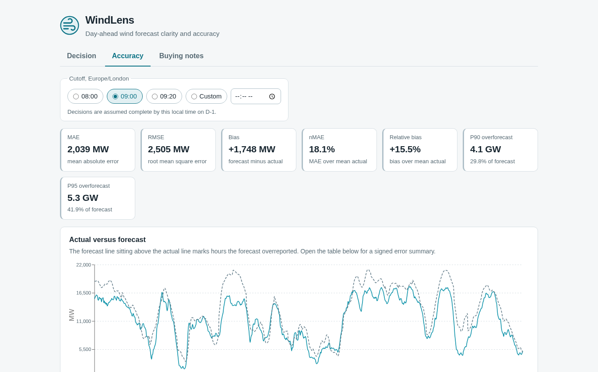
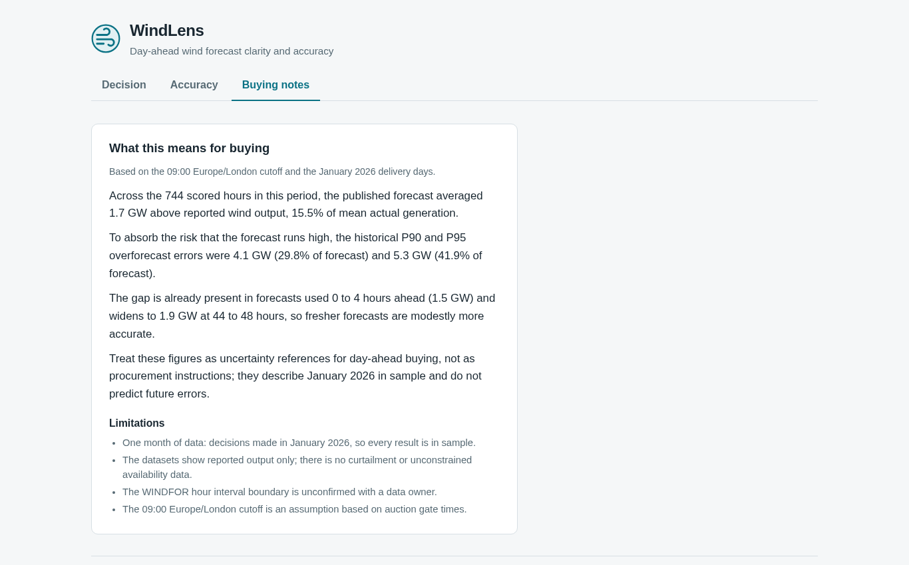
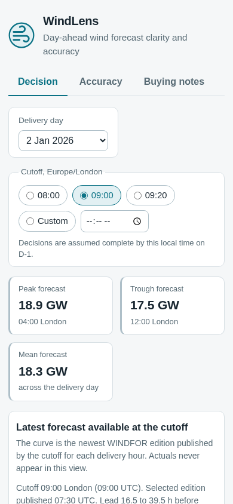

# WindLens

> Day-ahead wind forecast clarity and accuracy

Live app: **https://tcnswzd.vercel.app**

[](https://github.com/Narayan201120/tcnswzd/actions/workflows/ci.yml)

WindLens is decision support for GB day-ahead wind power buying. It pairs the national wind
forecast available at decision time (Elexon WINDFOR) with reported wind outturn (Elexon FUELHH)
for the January 2026 decision month, measures how far and how often the forecast misses, and
translates the results into plain language for a buying team.

| Decision view | Accuracy view |
| --- | --- |
|  |  |
|  |  |

## What it does

1. **See the decision clearly.** Pick a delivery day and a decision cutoff; WindLens shows the
   exact forecast edition that was available at that moment, when it was published, and how every
   earlier edition had evolved. No actuals leak into this view.
2. **Quantify the error.** Compare forecast against outturn over the whole month: MAE, RMSE,
   bias, percentiles, error by hour of day, by lead time, and the full distribution, plus a
   one-sided overforecast buffer you can reason about when buying.
3. **Read it in plain language.** A buying notes view turns the metrics into sentences, with the
   limitations stated honestly.

## Quick start

Docker (recommended):

```bash
docker compose up --build
```

- Frontend: http://localhost:3000
- Backend API: http://localhost:8000 (health at `/health`, docs at `/docs`)
- The frontend proxies `/api` and `/health` to the backend, so the browser stays same origin.

Without Docker:

```bash
# Backend (Python 3.12)
python -m venv .venv
.venv/bin/pip install -r backend/requirements-dev.txt
.venv/bin/uvicorn backend.app:app --host 0.0.0.0 --port 8000

# Frontend (Node 22), in a second terminal
cd frontend
npm ci
npm run dev -- --host 0.0.0.0   # port 3000, proxies /api and /health to 8000
```

Tests, lint, and maintenance:

```bash
.venv/bin/python -m pytest                                   # backend tests
.venv/bin/coverage run -m pytest                             # then:
.venv/bin/coverage report --include=backend/metrics.py       # metrics module coverage
.venv/bin/ruff check backend tests                           # backend lint
cd frontend && npm test && npm run lint                      # frontend tests and lint
.venv/bin/python -m backend.ingest                           # refresh snapshot (contacts Elexon, maintenance only)
```

## Repository guide

```
tcnswzd/
  api/index.py            Vercel entrypoint; imports the same FastAPI app object
  backend/
    app.py                FastAPI route handlers
    metrics.py            pure selection, alignment, and metric functions
    domain.py             timestamp parsing and record validation
    models.py             pydantic response models
    store.py              snapshot loading, resolved from the file location
    ingest.py             Elexon ingestion (maintenance command, not request path)
    Dockerfile            backend runtime image (python 3.12 slim, non root)
    requirements.txt      Docker runtime dependencies (includes uvicorn)
    requirements-dev.txt  development and CI dependencies (coverage, httpx, pytest, ruff)
    data/january_2026.json  committed snapshot: 1,488 actual rows, 17,864 forecast vintages
  frontend/
    src/api/client.ts     typed API client; the only place fetch is called
    src/lib/              formatting helpers, derived values, buying notes builder
    src/components/       shared UI components (charts, controls, states, tables)
    src/views/            Decision, Accuracy, and Buying notes views
    src/__tests__/        Vitest and Testing Library tests
    Dockerfile            multi stage build; nginx serves static and proxies /api
    nginx.conf            same origin proxy for /api and /health
    package.json          scripts and dependencies
  docs/
    DESIGN.md             data research, contract, and bias analysis
    VIDEO_SCRIPT.md       demo script for the customer and tech lead recordings
    archive/HANDOFF.md    phase by phase build history
    samples/              small raw Elexon API samples
    screenshots/          UI captures used above
  scripts/                reproducible bias audit scripts
  tests/                  backend pytest suite
  docker-compose.yml      backend on 8000, frontend on 3000
  vercel.json             Vercel build settings and rewrites
  requirements.txt        Vercel function runtime dependencies (no uvicorn)
```

## Architecture

```
Elexon BMRS streams (FUELHH actuals, WINDFOR forecasts)
   |  python -m backend.ingest  (one time maintenance command)
   v
backend/data/january_2026.json      committed, versioned snapshot
   |
   v
FastAPI app (backend/app.py)  ----  pure functions in backend/metrics.py
   |                               selection at cutoff, hourly alignment, metrics
   |  /api/... and /health
   v
React + Vite static build
   Decision view | Accuracy view | Buying notes

Deployment split:
  Docker (local, review, CI):  uvicorn on 8000 + nginx on 3000 proxying /api and /health
  Vercel (production):         static frontend build + one Python function from the
                               same FastAPI app object, same origin, no CORS
```

Two requirements files, on purpose:

- Root `requirements.txt` lists `fastapi` and `pydantic` only. Vercel's Python runtime serves the
  ASGI app itself, so uvicorn is not deployed.
- `backend/requirements.txt` lists `fastapi`, `starlette`, and `uvicorn` for the Docker runtime
  image, which runs its own ASGI server. Development dependencies live in
  `backend/requirements-dev.txt`.

## Key decisions and assumptions

| Decision | Choice | Why |
| --- | --- | --- |
| Scope | Delivery days Jan 2 through Feb 1, 2026 | "Decisions made in January" means the D-1 decision date is in January. Covers all 31 decision days with complete actuals. |
| Decision cutoff | 09:00 Europe/London on D-1, configurable per request | Assumption: 20 minutes before the EPEX hourly gate (09:20 GMT) and 50 minutes before N2EX (09:50). Not a client commitment. |
| Forecast selection | Latest publishTime at or before the cutoff | Reconstructs the information actually available at decision time. |
| Hourly alignment | Forecast at UTC T vs mean of actuals at T and T+30 minutes | Treats the target as the hour beginning at T. Missing either half hour drops the target. |
| Error sign | Forecast minus actual | Positive means the forecast overreported. |
| Buffer | P90 and P95 of max(error, 0), in MW and percent of forecast | Historical overforecast reference, not a purchase recommendation. |
| Metrics stack | Python standard library (math, statistics) | Small, auditable, no analytics dependencies. |

## Findings: January 2026

Across the 744 scored decision hours (09:00 cutoff): mean actual 11,283.6 MW, MAE 2,038.91 MW,
RMSE 2,504.76 MW, signed bias **+1,747.89 MW**, relative bias **+15.49%**, nMAE 18.07%.

- The forecast averaged about **1.75 GW above reported output**. The gap is already present at
  short lead (+1,454.93 MW, 12.76% of mean actual, at 0 to 4 h) and grows slowly with lead,
  about 9.8 MW per additional hour, to +1,942.49 MW (17.55%) at 44 to 48 h.
- 27 of 31 delivery days have a positive mean error; the P90 and P95 overforecast buffers are
  **4,097.9 MW and 5,283.35 MW** (29.8% and 41.9% of forecast).
- This is **evidence, not proof, of a cause**. These datasets do not report curtailment or
  unconstrained wind availability, so the gap cannot be attributed. It is one month, in sample.
  A temporal alignment sensitivity (MAE minimum at a -2 h actual window shift, worth only 4.1%
  MAE) remains an open validation item with a data owner.

Full analysis: [docs/DESIGN.md](docs/DESIGN.md). Reproduce the tables with
`PYTHONPATH=. .venv/bin/python scripts/bias_diagnostic.py`.

## Metrics

| Metric | Definition |
| --- | --- |
| Error | forecast MW minus actual MW (positive = overforecast) |
| MAE | mean absolute error, MW |
| RMSE | root mean square error, MW |
| Bias | mean signed error, MW |
| nMAE | MAE as percent of mean actual |
| Relative bias | bias as percent of mean actual |
| MAPE | mean of percent errors over nonzero actuals only (exclusions reported) |
| Percentiles | signed P5/P10/P50/P90/P95 and absolute P50/P90/P95, linear interpolation |
| Buffer | P90/P95 of max(error, 0) in MW and as percent of forecast |

## API

Base path `/api` in production and Docker. Dates are `YYYY-MM-DD`; cutoff is `HH:MM`
Europe/London. Errors return `{"detail": "..."}` with HTTP 422 or 503.

| Endpoint | Parameters | Returns |
| --- | --- | --- |
| GET /health | none | snapshot status and row counts |
| GET /api/forecast/latest | delivery_date, cutoff | actual free forecast at the cutoff per delivery hour |
| GET /api/actual-vs-forecast | start, end, cutoff | chronological paired series with coverage counts |
| GET /api/accuracy/summary | start, end, cutoff | all headline metrics, percentiles, buffers |
| GET /api/accuracy/by-hour | start, end, cutoff | MAE and bias by local delivery clock hour |
| GET /api/accuracy/by-lead-time | start, end | MAE and bias per one hour lead bucket, all January vintages |
| GET /api/accuracy/distribution | start, end, cutoff | signed and absolute error arrays |
| GET /api/accuracy/cutoff-sensitivity | start, end, optional cutoff | metrics for 08:00, 09:00, 09:20 plus supplied |
| GET /api/revisions | delivery_date, cutoff | every published edition for a day, selection marked |

## Testing and CI

- Backend: 20 pytest tests, including metric edge cases and the golden worked example
  (Jan 2, 00:00 UTC: forecast 18,781 MW vs actual mean 15,366.5 MW, error +3,414.5 MW).
  Metrics module coverage: 100%.
- Frontend: 29 Vitest and Testing Library tests covering formatting, derivations, the buying
  notes builder (including a negative bias case), the cutoff control, and loading, error, and
  empty states. ESLint and Prettier configured.
- CI runs backend, frontend, and docker jobs on every push and pull request; the docker job
  builds both images, waits for healthy containers, and asserts the smoke values above.

## Limitations and next steps

- One month of data, fully in sample. Results describe January 2026, not the future.
- FUELHH reports generation by fuel type; WINDFOR covers farms visible to the system operator.
  The populations may differ, which caps how tightly error can be interpreted.
- No curtailment or unconstrained availability field exists in these datasets; the positive bias
  is measured, not explained.
- The WINDFOR hourly interval boundary is unconfirmed with a data owner (the empirical -2 h
  alignment minimum remains open).
- The 09:00 cutoff is an assumption based on auction gate times.
- Next steps: more months, an availability feed, bias adjusted forecast display by default, and
  per region breakdowns if Elexon exposes them.

## AI tools disclosure

Claude (chat) and an AI coding agent were used for domain research, design, implementation,
tests, documentation, and deployment tooling for this project. The author reviewed, verified,
and takes responsibility for all of it: every metric in this README is reproducible from the
committed snapshot with the scripts in `scripts/`, and every claim is traceable to
[docs/DESIGN.md](docs/DESIGN.md).
